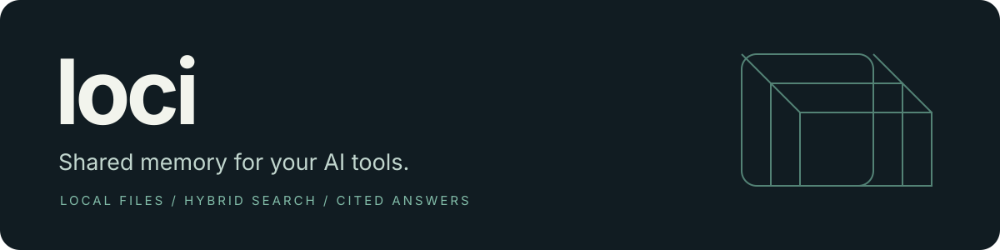
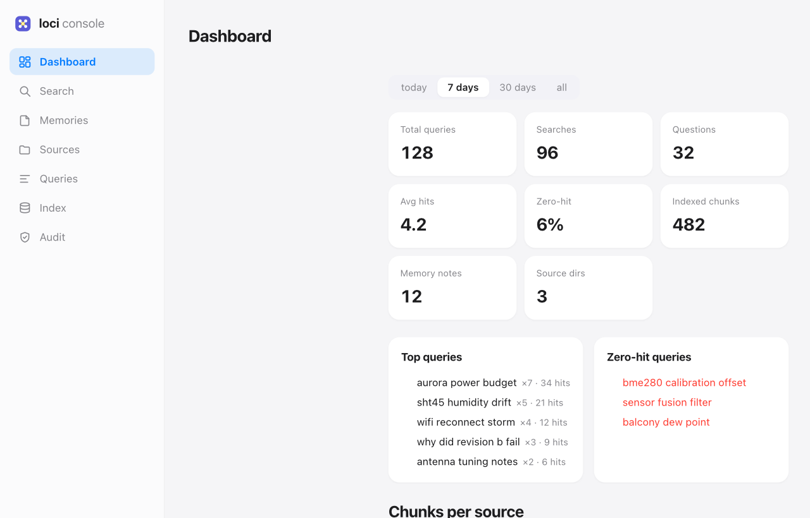
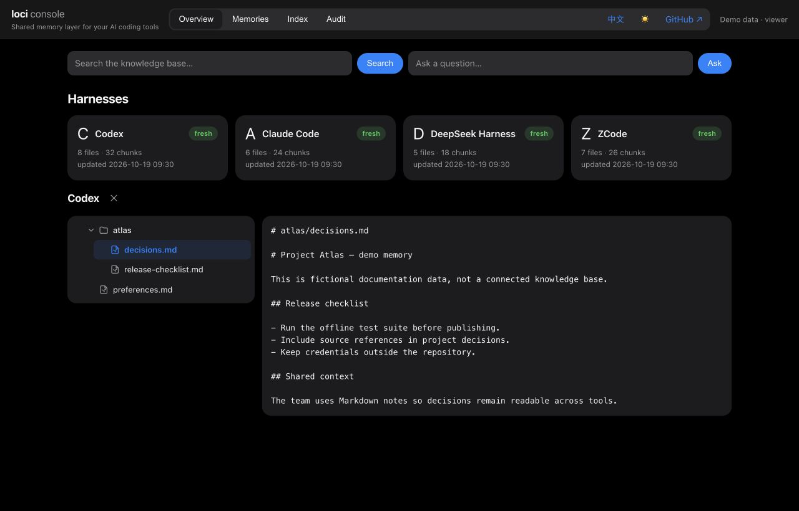
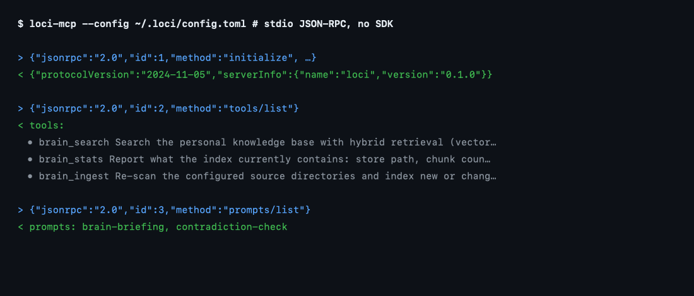

<p align="center">
  
</p>

<p align="center">
  <a href="README.md">English</a> · <a href="README.zh-CN.md">简体中文</a> · <a href="README.zh-TW.md">繁體中文</a> · <a href="README.ja.md">日本語</a> · <a href="README.ko.md">한국어</a>
</p>

<p align="center">
  <a href="https://github.com/IvenKooLab/loci/actions/workflows/ci.yml"></a>
  <a href="https://pypi.org/project/loci-rag/"></a>
  
  
  <a href="LICENSE"></a>
</p>

**散らばったノート、プロジェクト文書、Agent の記憶を、検索・質問・出典確認ができる知識ベースに。ターミナル、ブラウザー、MCP クライアントから使えます。**

loci はベクトル検索と BM25 を組み合わせ、回答に「ファイル > セクション」の引用を付けます。ファイルとインデックスはローカルに保存され、埋め込みとチャットのリクエストは設定したサービスに送信されます。ローカルモデルでオフライン運用することもできます。

**MCP が本体です。** `loci-mcp` を Claude Desktop / Cursor / Cline などの MCP ホストに登録すれば、アシスタントが知識ベース全体をツールとして使えます。Web コンソールとデスクトップ版は同じインデックスの別フロントエンドにすぎず、必須ではありません。

[クイックスタート](#クイックスタート) · [Web コンソール](#web-コンソール) · [AI ツールとの接続](#ai-ツールとの接続) · [詳細ガイド（英語）](docs/guide.en.md)



*実際の UI を架空のデモデータで撮影しています。個人の知識ベース、アカウント、API キーには接続していません。件数は説明用の値です。*

<details>
<summary>ダークテーマのプレビュー</summary>



</details>


## 何をどこに置くか

3 種類の「記憶」は失敗のしかたが違います。混ぜることが典型的な誤用です。

| 種類 | 置き場所 | 取り出し方 | 向いているもの | 向かないもの |
|---|---|---|---|---|
| 自由テキストの知識 | メモリノート（`brain_remember`） | ハイブリッド検索 | 「X について何を知っているか」 | タスクの正確な再開 |
| 構造化ステート | `state/<type>/<key>.json`（`brain_state_save`） | キーで正確に取得、ランキングなし | タスクのスナップショット、エンティティ情報、セッションを跨いで残したい値 | 曖昧に探したい散文 |
| 対話中のスロット | ホスト Agent のセッション | ホスト自身のコンテキスト | そのターンの変数 | セッションを跨いで残したいもの |

判断基準：検索が「似ているが誤った」レコードを返すことがバグなら、それはステートです。キーを付け、`brain_state_get type=task key=8f3c` で正確に取得します。毎ターン変わるスロットをベクタ DB に入れないでください。ステートは手編集できるプレーン JSON で、**意図的に**ベクタインデックスには入れません。省略ではなく境界です。

## メモリの健全性

検索や回答がメモリノートを使うたび、台帳（インスタンス配下の `citations.jsonl`）に 1 行記録されます。`loci memory-health` はこれとフィードバック（`loci feedback bad`。bad 評価は該当チャンクを以降の検索で沈めます）と経過日数を突き合わせ、`corrected`（使用後に bad と評価）と `never-cited`（古く未引用）をレビュー候補として示します。証拠にもとづく `brain_forget` のためのものです。loci が見えるのはツール呼び出しだけで対話は見えないため、訂正は明示的なフィードバック経由でのみ届きます。レポートが検索動作を黙って書き換えることはありません。

## できること

| 目的 | loci の機能 |
|---|---|
| 過去の意思決定を探す | ディレクトリを横断するハイブリッド検索。タグ・パス・日付で絞り込み |
| 回答の根拠を確認する | セクション単位の引用と、任意の主張別検証 |
| AI ツールを切り替えても文脈を保つ | MCP で同じインスタンスを共有。長期記憶は Markdown で保存 |
| 各 Agent の記憶を把握する | harness の自動検出、ファイル閲覧、統計、要約 |
| 画面から知識ベースを管理する | 検索、質問、記憶の編集、インデックス更新、監査ログ |

Markdown、テキスト、HTML、org-mode、チャットのエクスポートに標準対応。PDF、Word、OCR はオプションです。既存のエディターや Obsidian vault もそのまま使えます。

## クイックスタート

### まず設定なしで動かす

```bash
pip install loci-rag
loci demo
```

`loci demo` は架空のノート6枚を `./loci-demo-notes` にコピーし、チャンク化して3つの例題に回答します。引用は `ファイル > セクション` まで付きます。`config.toml` も API キーもネットワークも不要です。キーワード検索（BM25、ハイブリッド検索でベクトル結果と融合される側のランキング）だけを使いますが、それが要点です。キーを渡す前に、まず動くものを。あとで `[embed]` を足せば同じインデックスがハイブリッドになります。

### 自分のノートを索引する

**Python 3.11+** が必要です。設定例を含むソースから始める場合：

```bash
git clone https://github.com/IvenKooLab/loci.git
cd loci
python -m pip install -e .
cp config.example.toml config.toml
```

`config.toml` の `[llm]`、`[embed]` を設定し、`[[sources]].path` をノートのディレクトリに変更します。埋め込みサービスには `/embeddings` が必要です。チャットと埋め込みに別々のプロバイダーを使えます。

```bash
loci ingest
loci search "デプロイの決定"
loci ask "デプロイ方法はどう決めましたか？その理由は？"
```

設定済みなら `python -m pip install loci-rag` でインストールし、`LOCI_HOME` でインスタンスのディレクトリを指定できます。PDF・Word 対応：`python -m pip install 'loci-rag[pdf,docx]'`。

> キーは `BRAIN_LLM_API_KEY`、`BRAIN_EMBED_API_KEY` でも指定できます。埋め込みモデルの変更後は `loci ingest --force` で再構築してください。

## Web コンソール

```bash
loci serve-http
```

**[127.0.0.1:8765/ui](http://127.0.0.1:8765/ui)** を開きます。UI は英語・簡体字中国語、ライト・ダークの切り替えに対応。フロントエンドのビルドは不要です。

初期設定ではループバックからの匿名接続に管理者権限を付与します。リバースプロキシや SSH トンネル経由では `[http] local_admin = false` とロール別トークンを設定してください。[アクセス制御（英語）](docs/guide.en.md#web-console)。

DeepSeek Harness では [loci-dsh](https://github.com/IvenKooLab/loci-dsh) を使い、同じ HTTP バックエンドの検索・質問・記憶の保存をワークベンチに追加できます。

## AI ツールとの接続

MCP クライアントで**同じ `LOCI_HOME`** を指定すると、設定・インデックス・記憶を共有できます。

```json
{
  "mcpServers": {
    "loci": {
      "command": "loci-mcp",
      "env": { "LOCI_HOME": "/absolute/path/to/your/loci-instance" }
    }
  }
}
```

ディレクトリには `config.toml` を置いてください。`loci-mcp` が見つからない場合は実行ファイルの絶対パスを指定します。

| MCP ツール | 用途 |
|---|---|
| `brain_search` · `brain_ask` | 検索と出典付きの回答 |
| `brain_remember` · `brain_forget` | 長期記憶の保存と撤回 |
| `brain_links` · `brain_graph` | ノートリンクと知識の関係を調べる |
| `brain_wiki` · `brain_harness` | 知識の整理と Agent の記憶管理 |
| `brain_stats` · `brain_ingest` | インデックスの確認と更新 |



*実際の `loci-mcp` の出力：`initialize`、`tools/list`、`prompts/list`。*

### ネイティブ版（Rust）

同じ検索パイプラインと同じ MCP サーフェスを、Python ランタイムなしで——単一バイナリ、
インデックスはデータベースディレクトリではなく 1 つの SQLite ファイル：

```bash
cargo build --release -p loci-cli     # native/ 内で
./target/release/loci-mcp --config ~/.loci/config.toml
```

状態：コアと MCP は完成、パッケージングとデスクトップシェルは進行中。移植範囲と挙動を固定するテストは [`native/`](native/) を参照。
**2 つのビルドのインデックスは共有されません**——ネイティブ版は ChromaDB のインデックスを読みません。

## 日々の使い方

```bash
loci watch
loci remember "デモにはステージング環境を使う" --title "デモ環境の決定"
loci search "デモ環境" --tag memory
loci ask "デモの準備で注意することは？" --verify
loci harness
```

変更されたファイルを差分でインデックス化し、記憶は読みやすい Markdown のまま保存します。複数のマシンでは元ファイルと記憶を同期し、インデックスは各マシンで再構築してください。認証情報はリポジトリに保存しないでください。

## ドキュメント

[使用ガイド（英語）](docs/guide.en.md) · [設定例](config.example.toml) · [アーキテクチャ](docs/ARCHITECTURE.md) · [変更履歴](CHANGELOG.md) · [ロードマップ](docs/roadmap.md) · [コントリビューション](CONTRIBUTING.md)

実行時には OpenAI 互換 SDK と ChromaDB を使用し、LangChain や LlamaIndex には依存しません。テストは API キーなしでオフライン実行できます。

```bash
python -m pip install -e '.[dev,pdf]'
pytest
```

[GitHub](https://github.com/IvenKooLab/loci) · [Gitee](https://gitee.com/IvenKooLab/loci) · [MIT](LICENSE)
