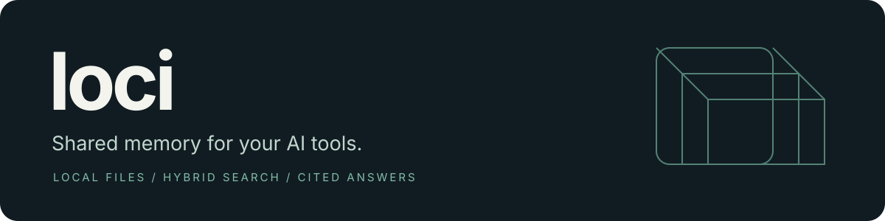
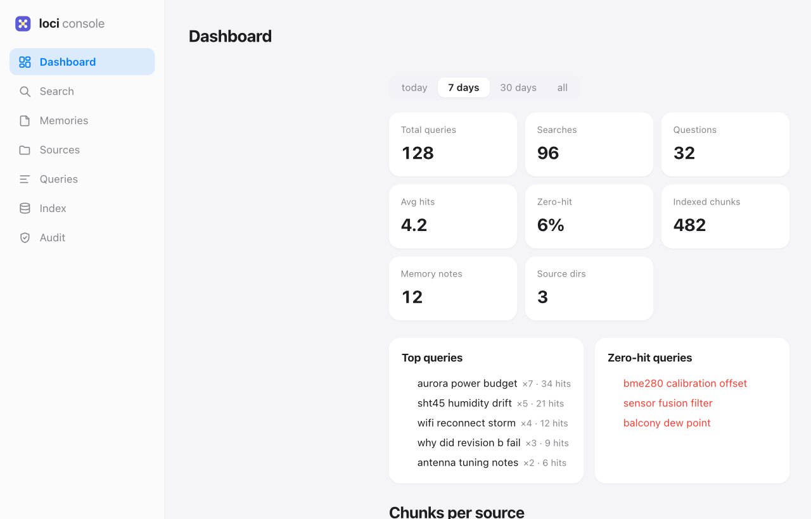
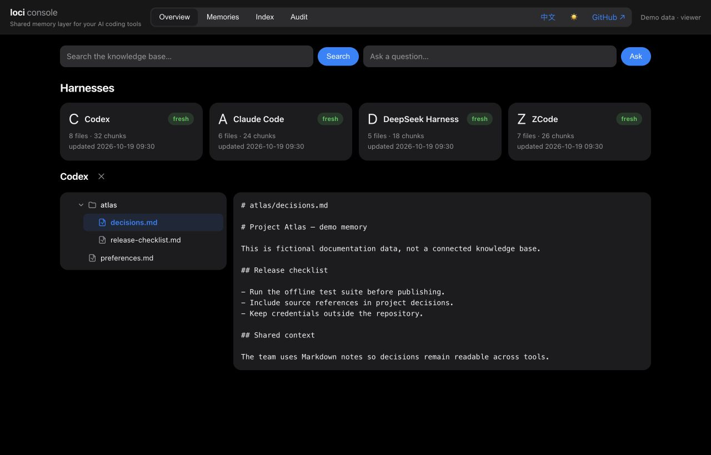
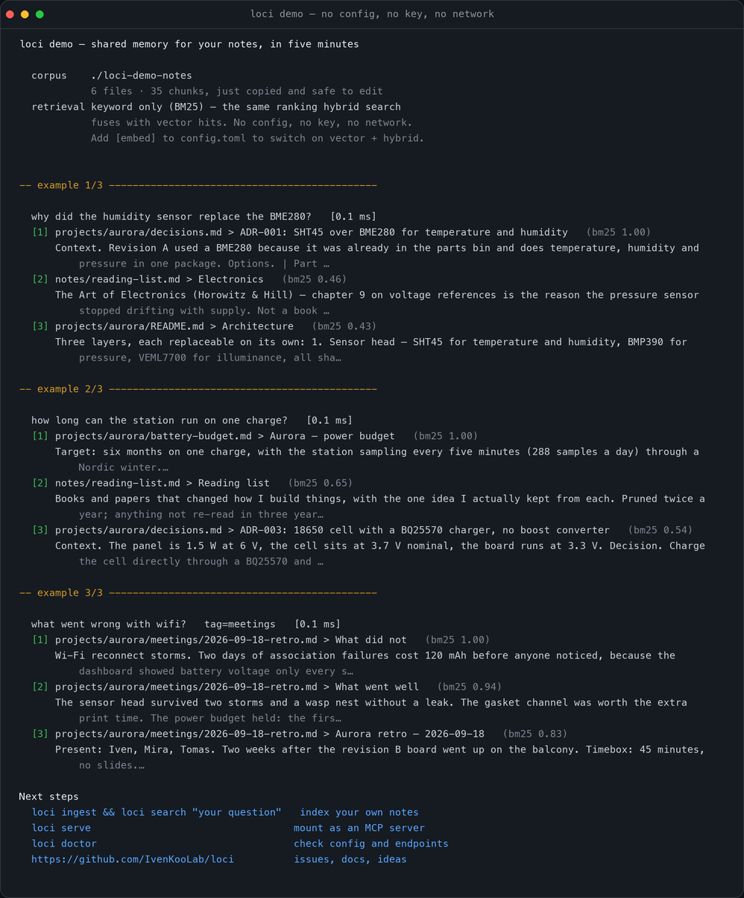
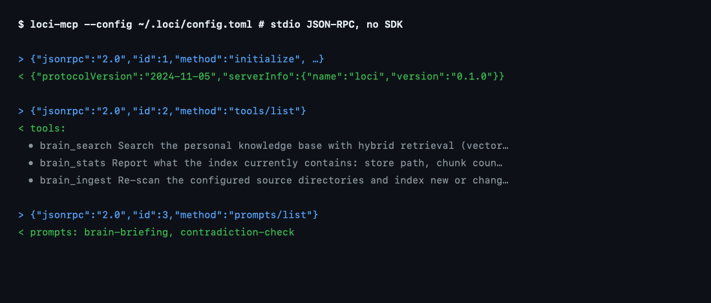

<p align="center">
  
</p>

<p align="center">
  <a href="README.md">English</a> · <a href="README.zh-CN.md">简体中文</a> · <a href="README.zh-TW.md">繁體中文</a> · <a href="README.ja.md">日本語</a> · <a href="README.ko.md">한국어</a>
</p>

<p align="center">
  <a href="https://github.com/IvenKooLab/loci/actions/workflows/ci.yml"></a>
  <a href="https://pypi.org/project/loci-rag/"></a>
  
  
  <a href="native/"></a>
  <a href="LICENSE"></a>
</p>

<!-- mcp-name: io.github.IvenKooLab/loci -->

**Turn scattered notes, project docs and agent memories into a knowledge base you can search and ask questions about — as an MCP server, from your terminal, or in the browser.**

loci combines vector search with BM25 and returns answers with `file > section` citations. Your files and index stay on your machine. Embedding and chat requests go to the providers you configure; local endpoints can keep the entire workflow offline.

**MCP is the point.** Mount `loci-mcp` in Claude Desktop, Cursor, Cline or any other MCP host and your assistant gets the whole knowledge base as tools. The console and a desktop shell are alternate front-ends to the same index — you never need them.

[Quick start](#quick-start) · [MCP setup](#connect-your-ai-tools) · [Web console](#web-console) · [Usage guide](docs/guide.en.md) · [中文说明](README.zh-CN.md)



*Actual console UI with fictional demo data. No personal knowledge base, account or API key is connected; counts are illustrative.*

<details>
<summary>Dark theme preview</summary>



</details>

## What you can do

| Need | How loci helps |
|---|---|
| Find a decision buried in your notes | Hybrid search across directories, with tag, path and date filters |
| Ask a question and check the evidence | Answers cite source sections; optional claim-by-claim verification |
| Carry context between AI tools | MCP tools share one instance; durable memories are Markdown files |
| See what each coding agent remembers | Harness discovery, file browsing, per-tool stats and digest notes |
| Manage the knowledge base visually | Built-in Web console for search, Q&A, memories, indexing and audit |

Markdown, text, HTML, org-mode and chat exports work out of the box. Optional extras add PDF, Word and OCR support. Keep using your existing note editor or Obsidian vault.

## Quick start

### Try it first, with nothing configured

```bash
pip install loci-rag
loci demo
```

`loci demo` copies six fictional notes into `./loci-demo-notes`, chunks them and
answers three example questions — cited down to `file > section` — with no
`config.toml`, no API key and no network. It is keyword-only (BM25, the same
ranking hybrid search fuses with vector hits), which is exactly the point:
something runs before you commit a key. Add `[embed]` later and the same index
goes hybrid.



*Actual `loci demo` output on the bundled sample notes; paths shortened, timings vary.*

### Index your own notes

Requires **Python 3.11+**. Start from source so the example configuration is available:

```bash
git clone https://github.com/IvenKooLab/loci.git
cd loci
python -m pip install -e .
cp config.example.toml config.toml
```

Edit `config.toml`: fill in `[llm]` and `[embed]`, and change `[[sources]].path` to your notes directory. The embedding endpoint must support `/embeddings`; chat and embeddings may use different providers.

```bash
loci ingest
loci search "deployment decisions"
loci ask "What did we decide about deployment, and why?"
```

Already have a configuration? Install the package with `python -m pip install loci-rag` and set `LOCI_HOME` to your instance directory. For optional document support, use `python -m pip install 'loci-rag[pdf,docx]'`.

> API keys can be supplied through `BRAIN_LLM_API_KEY` and `BRAIN_EMBED_API_KEY`. After changing the embedding model, rebuild with `loci ingest --force`.

## Web console

```bash
loci serve-http
```

Open **[127.0.0.1:8765/ui](http://127.0.0.1:8765/ui)** to browse harness memories, search, ask questions, edit shared notes and inspect indexing activity. Clicking a search result opens an evidence pane with the passage it was cut from — the `file > section` citation, checkable without leaving the console. The console includes Chinese/English and light/dark switches; no frontend build is required.

By default, anonymous loopback clients have admin access. Behind a reverse proxy or SSH tunnel, set `[http] local_admin = false` and configure role-based tokens. See [access control](docs/guide.en.md#web-console).

For DeepSeek Harness, [loci-dsh](https://github.com/IvenKooLab/loci-dsh) brings search, Q&A and memory capture into the Harness workbench through the same HTTP backend.

## Connect your AI tools

Point each MCP client at the **same `LOCI_HOME`** so they share the same config, index and memory files:

```json
{
  "mcpServers": {
    "loci": {
      "command": "loci-mcp",
      "env": { "LOCI_HOME": "/absolute/path/to/your/loci-instance" }
    }
  }
}
```

Use an absolute executable path if your client cannot find `loci-mcp`. The instance directory must contain your `config.toml`.

| MCP tools | Purpose |
|---|---|
| `brain_search` · `brain_ask` | Retrieve excerpts or get cited answers |
| `brain_remember` · `brain_forget` | Store or retract durable memories |
| `brain_links` · `brain_graph` | Explore note links and extracted relations |
| `brain_wiki` · `brain_harness` | Consolidate knowledge and inspect agent memories |
| `brain_stats` · `brain_ingest` | Inspect and refresh the index |

The server also exposes note resources and briefing, study-plan and contradiction-check prompts. See the [MCP guide](docs/guide.en.md#mount-it-in-any-mcp-host) for details.



*Actual `loci-mcp` output: `initialize`, `tools/list` and `prompts/list` on the real binary.*

### Native build (Rust)

The same retrieval pipeline and MCP surface, with no Python runtime to install —
one binary, and the index is a single SQLite file instead of a database
directory:

```bash
cargo build --release -p loci-cli     # in native/
./target/release/loci-mcp --config ~/.loci/config.toml
```

Status: core + MCP complete; packaging and the desktop shell are in progress.
See [`native/`](native/) for what is ported and the fidelity tests that pin it
(chunking, the frozen `default` tokenizer, the CJK bigram decoy case, RRF, and
incremental ingest). **The two builds keep separate indexes** — a ChromaDB
instance is not read by the native one; a migration command is on the list.

## A small daily workflow

```bash
loci watch                            # keep changed documents indexed
loci remember "Use staging for demos" --title "Demo environment"
loci search "demo environment" --tag memory
loci ask "How should I prepare a demo?" --verify
loci harness                          # inspect detected agent memories
```

Indexing is incremental. Notes stay readable as Markdown. For multiple machines, sync source files and memory notes, then rebuild each local index; keep credentials out of the repository.

<details>
<summary><strong>See a retrieval session</strong></summary>


The [usage guide](docs/guide.en.md#demo) includes the original bilingual retrieval example and a small evaluation you can rerun against your own corpus.

</details>

## Documentation

| Guide | Covers |
|---|---|
| [Usage guide](docs/guide.en.md) / [中文指南](docs/guide.zh-CN.md) | Commands, filters, harness setup, access control and local models |
| [Configuration example](config.example.toml) | Provider settings, source directories and runtime options |
| [Architecture](docs/ARCHITECTURE.md) | Modules and the retrieval pipeline |
| [Changelog](CHANGELOG.md) · [Roadmap](docs/roadmap.md) | Released changes and planned work |
| [Contributing](CONTRIBUTING.md) | Development conventions and offline testing |

loci uses the OpenAI-compatible SDK and ChromaDB, with no LangChain or LlamaIndex dependency. BM25, loaders and the MCP transport are implemented in the project.

```bash
python -m pip install -e '.[dev,pdf]'
pytest  # offline tests; no API keys required
```

Find loci on [Glama](https://glama.ai/mcp/servers/IvenKooLab/loci), [ModelScope](https://modelscope.cn/mcp/servers/IvenKooLab/loci) and [awesome-mcp-servers](https://github.com/punkpeye/awesome-mcp-servers). Source: [GitHub](https://github.com/IvenKooLab/loci) · [Gitee](https://gitee.com/IvenKooLab/loci). Licensed under [MIT](LICENSE).
